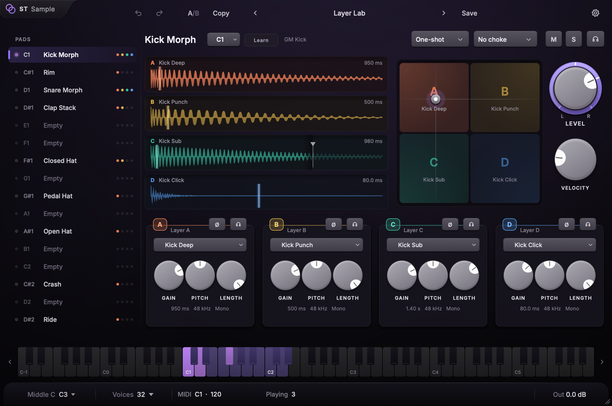

# ST Sample

A drum sampler. Drop a kick, snare or any one-shot onto a pad, map the pad to a MIDI key (C1, D#2, whatever your
piano roll uses) and play it. Every pad holds up to **four samples** that you blend on an **XY pad**: layer a deep
kick with a punchy one and a click, then move the dot to find the mix. VST3 and AU instrument for macOS (Apple
Silicon + Intel). Built on [st-shell](https://github.com/davidstokarski/st-shell).



**Download:** [ST-Sample-macOS.zip](https://github.com/davidstokarski/st-sample/releases/latest/download/ST-Sample-macOS.zip)
(see INSTALL.txt inside; builds are ad-hoc signed, so macOS may need `xattr -dr com.apple.quarantine` on the bundles).

## Features

- **16 pads**, each mapped to any MIDI note. Map with the note menu, by dragging or scrolling the note, with
  **Learn** (play a key on your controller), by clicking a key on the built-in keyboard while learning, or by
  dragging a pad from the list onto a key. Defaults follow the General MIDI drum map from C1.
- **Four layers per pad (A–D)** blended on an **XY pad**: equal-power weights, empty corners ignored, so a single
  sample plays at full level anywhere and layers cross-fade without a loudness dip.
- Per layer: **Gain**, **Pitch** (±24 semitones), **Start** and **Length** (drag the handles on the waveform; cuts fade
  so they never click), **phase invert**, **listen** (plays that layer on its own).
- Per pad: **Level** with **Pan** on its rim, **Velocity floor**, **One-shot / Gate** triggering, **choke groups**
  (closed hat chokes the open hat), mute, solo, rename, copy / paste.
- **Load samples anywhere**: drop files on a pad, a waveform lane, a corner of the XY pad, a layer bar, a key, or the
  window; or click to browse. **‹ ›** on a sample (or the mouse wheel) steps through the files in its folder and plays
  each one, so auditioning a folder of snares is quick. WAV, AIFF, FLAC, MP3, M4A, CAF, Ogg.
- **19 built-in sounds** (kicks, snares, clap, rim, hats, toms, cymbals, shaker, cowbell), synthesised, plus three
  factory kits (ST Kit, Layer Lab, Boom Kit): it makes sound the moment you load it.
- Everything is part of the state: sessions, presets and A/B hold the kit (sample paths, names) and every setting;
  loading, clearing and pasting are undoable. A sample that isn't found keeps its slot and path (shown as missing).
- Sample-accurate MIDI, cubic interpolation, up to 64 voices with click-free stealing. Samples load on a background
  thread; the audio thread never allocates, locks or frees sample memory.

## Build

Expects `../st-shell` next to this repo (otherwise fetched from GitHub) and JUCE 9.0.5 in `../.st-deps/JUCE-9.0.5`
(otherwise fetched). Command Line Tools are enough.

```bash
cmake -S . -B build -G Ninja -DCMAKE_BUILD_TYPE=Release
cmake --build build
```

Builds are copied to `~/Library/Audio/Plug-Ins/{VST3,Components}`. Validate the AU with `auval -v aumu Stsm StAu`.

Tests and UI snapshots:

```bash
cmake -S . -B build -DSTSAMPLE_BUILD_TESTS=ON && cmake --build build
./build/tests/StSamplePluginTests_artefacts/Release/StSamplePluginTests                     # engine, loading, state, stress
./build/tests/StSamplePluginTests_artefacts/Release/StSamplePluginTests --snapshot /tmp/snaps  # PNG renders of the UI
```

Release (universal build → zip with the .vst3 and .component): `scripts/release.sh` (see st-shell `docs/RELEASING.md`).

## Contributing

See the shared [contributor notes](https://github.com/davidstokarski/st-shell/blob/main/CONTRIBUTING.md) in ST Shell. All PRs to `main` need approval from @davidstokarski.
